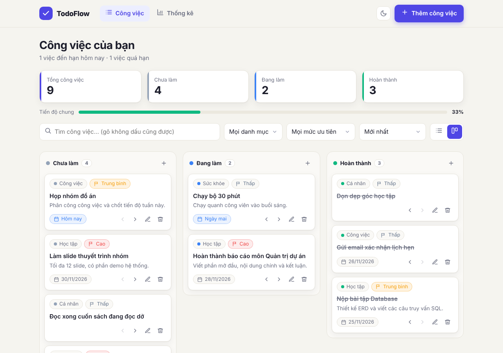
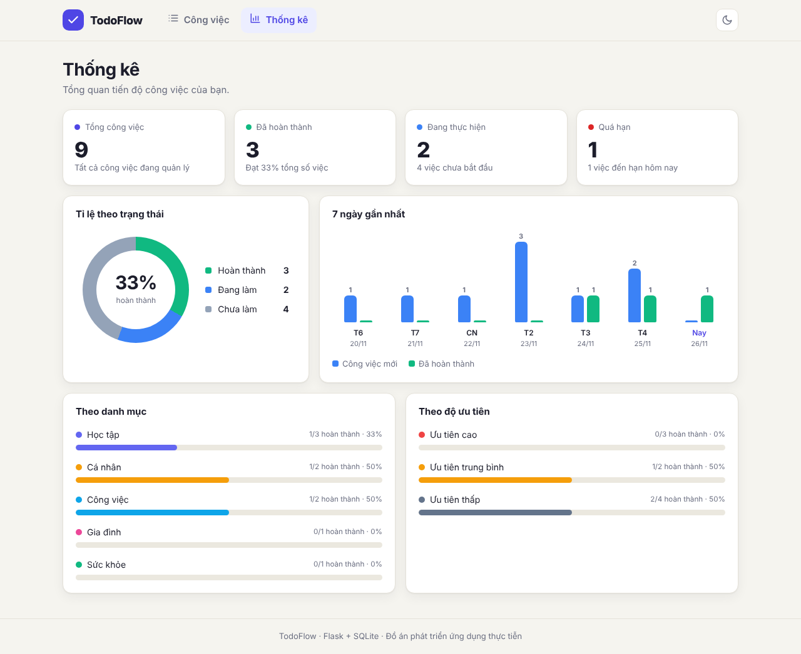
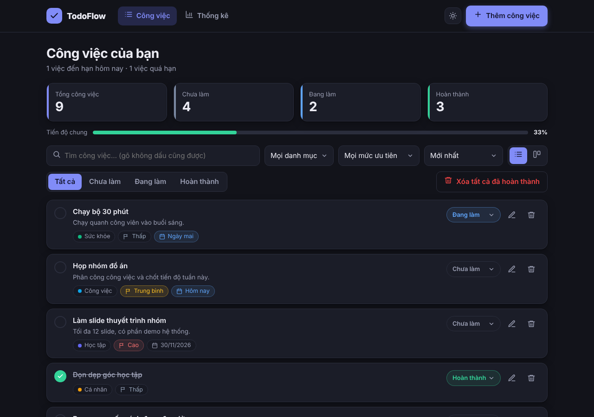
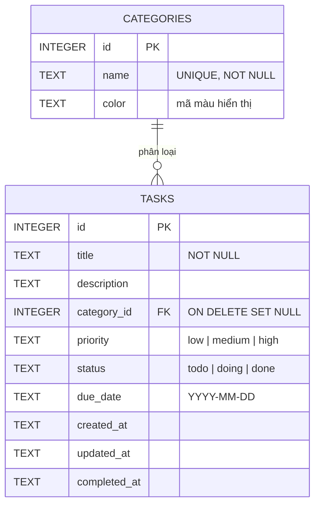

# TodoFlow – Ứng dụng quản lý công việc (TODO list)

Đồ án **Phát triển ứng dụng thực tiễn**: web TODO list viết bằng **Flask (Python)** + **SQLite**, giao diện HTML/CSS/JavaScript thuần (không cần cài Node.js hay build gì cả).

## Đáp ứng yêu cầu đề bài

| Yêu cầu | Cách thực hiện trong project |
|---|---|
| **Quản lý thông tin: thêm, sửa, xóa** | Nút **Thêm công việc**, biểu tượng ✏️ để sửa, 🗑️ để xóa (có hộp thoại xác nhận). Có thêm tìm kiếm (gõ không dấu vẫn tìm được), lọc theo trạng thái / danh mục / độ ưu tiên và sắp xếp. |
| **Cập nhật trạng thái** | 3 trạng thái: *Chưa làm → Đang làm → Hoàn thành*. Đổi bằng: tích tròn ✔ ở đầu dòng, menu trạng thái, nút ◀ ▶, hoặc **kéo thả** thẻ giữa các cột ở dạng bảng Kanban. |
| **Thống kê** | Tab **Thống kê**: tổng số việc, tỉ lệ hoàn thành (biểu đồ tròn), việc quá hạn / đến hạn hôm nay, biểu đồ 7 ngày gần nhất, thống kê theo danh mục và theo độ ưu tiên. |
| **Hình thiết kế / giao diện** | Giao diện hiện đại, responsive (dùng được trên điện thoại), có chế độ sáng/tối, 2 kiểu xem: danh sách và Kanban. |
| **Database** | SQLite với 2 bảng `categories` và `tasks` có khóa ngoại, ràng buộc `CHECK`, chỉ mục. Xem `schema.sql` và sơ đồ ERD bên dưới. |
| **Hệ thống hoàn chỉnh** | Backend REST API + Frontend + Database chạy thống nhất, có kiểm tra dữ liệu đầu vào, có bộ test tự động. |

## Giao diện

| Dạng danh sách | Dạng Kanban (kéo thả để đổi trạng thái) |
|---|---|
|  |  |

| Thống kê | Chế độ tối |
|---|---|
|  |  |

## Công nghệ

- **Backend:** Python 3.9+, Flask
- **Database:** SQLite (có sẵn trong Python, không cần cài thêm)
- **Frontend:** HTML5, CSS3, JavaScript (ES6), không dùng thư viện ngoài

## Cách chạy

Yêu cầu: đã cài [Python 3.9 trở lên](https://www.python.org/downloads/).

```bash
# 1. Tải code về và mở terminal trong thư mục project
cd todo-app

# 2. (Khuyến nghị) tạo môi trường ảo
python -m venv venv
venv\Scripts\activate          # Windows
# source venv/bin/activate     # macOS / Linux

# 3. Cài thư viện
pip install -r requirements.txt

# 4. Chạy ứng dụng
python app.py
```

Mở trình duyệt vào **http://127.0.0.1:5000**.

Lần chạy đầu tiên, ứng dụng tự tạo file database `data/todo.db` và nạp vài công việc mẫu để dễ demo. Muốn bắt đầu lại từ đầu: tắt app, xóa file `data/todo.db`, chạy lại.

### Chạy kiểm thử

```bash
python -m unittest discover -s tests -v
```

## Cấu trúc thư mục

```
todo-app/
├── app.py              # Flask: các route + REST API
├── database.py         # Kết nối SQLite, khởi tạo database
├── schema.sql          # Câu lệnh tạo bảng (cấu trúc database)
├── seed.sql            # Dữ liệu mẫu (chỉ nạp lần đầu)
├── requirements.txt    # Danh sách thư viện Python
├── templates/
│   └── index.html      # Giao diện (1 trang)
├── static/
│   ├── css/style.css   # Giao diện, chế độ sáng/tối, responsive
│   └── js/app.js       # Xử lý giao diện, gọi API
├── tests/
│   └── test_api.py     # Test tự động
├── docs/screenshots/   # Ảnh chụp giao diện dùng trong README
└── data/               # Chứa todo.db (tự tạo, không đẩy lên GitHub)
```

## Thiết kế cơ sở dữ liệu



## Danh sách API

| Method | Đường dẫn | Chức năng |
|---|---|---|
| GET | `/api/tasks` | Lấy danh sách. Tham số: `q`, `status`, `category_id`, `priority`, `sort` (`newest`, `oldest`, `due`, `priority`, `title`) |
| GET | `/api/tasks/<id>` | Xem chi tiết 1 công việc |
| POST | `/api/tasks` | Thêm công việc |
| PUT | `/api/tasks/<id>` | Sửa công việc |
| PATCH | `/api/tasks/<id>/status` | Cập nhật trạng thái |
| DELETE | `/api/tasks/<id>` | Xóa công việc |
| DELETE | `/api/tasks/completed` | Xóa tất cả công việc đã hoàn thành |
| GET | `/api/categories` | Danh sách danh mục |
| GET | `/api/stats` | Số liệu thống kê |

## Đưa lên GitHub

1. Tạo repository mới trên [github.com/new](https://github.com/new) (để trống, không tick *Add README*).
2. Mở terminal trong thư mục project và chạy:

```bash
git init
git add .
git commit -m "Initial commit: TodoFlow"
git branch -M main
git remote add origin https://github.com/<ten-tai-khoan>/<ten-repo>.git
git push -u origin main
```

> **Lưu ý:** GitHub chỉ lưu mã nguồn, không chạy được Flask. Nếu cần có đường link để thầy xem trực tiếp, có thể deploy miễn phí lên [Render](https://render.com) hoặc [PythonAnywhere](https://www.pythonanywhere.com).
