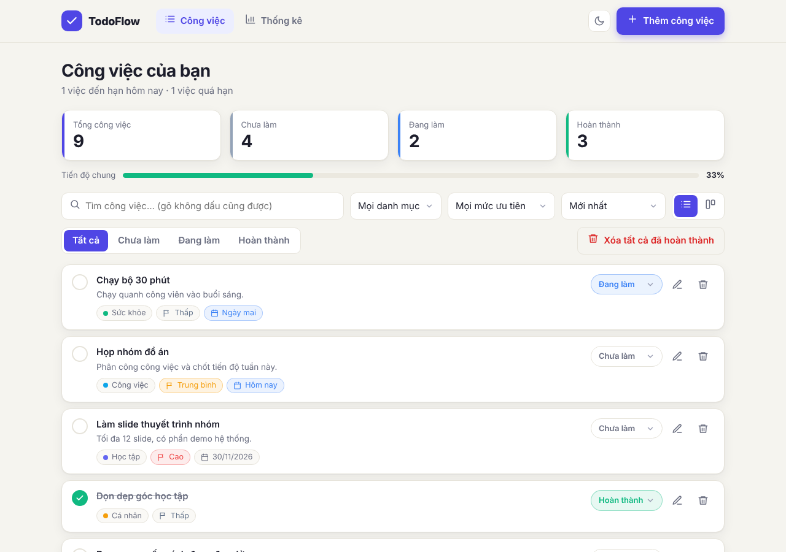
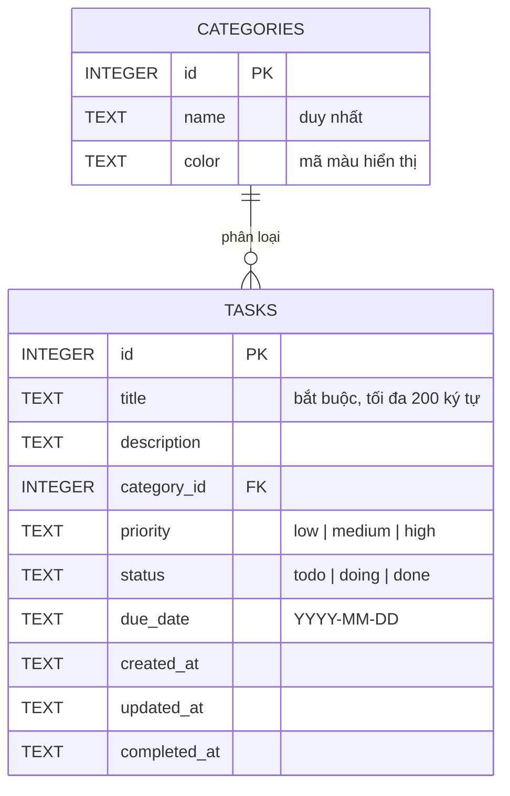

# TodoFlow – Ứng dụng quản lý công việc (TODO list)

Đồ án **Phát triển ứng dụng thực tiễn**: web app TODO list chạy **thẳng trên trình duyệt** – không cần cài Python, Node.js hay server gì cả. Dữ liệu được lưu bằng **IndexedDB** (cơ sở dữ liệu có sẵn trong trình duyệt).

## 🌐 Dùng thử

**Link web:** `https://<ten-tai-khoan>.github.io/<ten-repo>/` *(có sau khi bật GitHub Pages – xem hướng dẫn bên dưới)*

Hoặc tải code về, **bấm đúp vào file `index.html`** là dùng được ngay.

## Đáp ứng yêu cầu đề bài

| Yêu cầu | Cách thực hiện trong project |
|---|---|
| **Quản lý thông tin: thêm, sửa, xóa** | Nút **Thêm công việc**, biểu tượng ✏️ để sửa, 🗑️ để xóa (có hộp thoại xác nhận). Có thêm tìm kiếm (gõ không dấu vẫn tìm được), lọc theo trạng thái / danh mục / độ ưu tiên và sắp xếp. |
| **Cập nhật trạng thái** | 3 trạng thái: *Chưa làm → Đang làm → Hoàn thành*. Đổi bằng: tích tròn ✔ ở đầu dòng, menu trạng thái, nút ◀ ▶, hoặc **kéo thả** thẻ giữa các cột ở dạng bảng Kanban. |
| **Thống kê** | Tab **Thống kê**: tổng số việc, tỉ lệ hoàn thành (biểu đồ tròn), việc quá hạn / đến hạn hôm nay, biểu đồ 7 ngày gần nhất, thống kê theo danh mục và theo độ ưu tiên. |
| **Hình thiết kế / giao diện** | Giao diện hiện đại, responsive (dùng được trên điện thoại), có chế độ sáng/tối, 2 kiểu xem: danh sách và Kanban. |
| **Database** | IndexedDB với 2 bảng (object store) `categories` và `tasks`, có chỉ mục, kiểm tra dữ liệu đầu vào. Xem sơ đồ ERD bên dưới và file `js/db.js`. |
| **Hệ thống hoàn chỉnh** | Giao diện + xử lý nghiệp vụ + cơ sở dữ liệu chạy thống nhất, dữ liệu còn nguyên khi tắt/mở lại trình duyệt. |

## Giao diện

| Dạng danh sách | Dạng Kanban (kéo thả để đổi trạng thái) |
|---|---|
|  |  |

| Thống kê | Chế độ tối |
|---|---|
|  |  |

## Công nghệ

- HTML5, CSS3, JavaScript (ES6) thuần – không dùng thư viện hay framework ngoài
- IndexedDB làm cơ sở dữ liệu (tự chuyển sang localStorage nếu trình duyệt chặn IndexedDB)

## Cấu trúc thư mục

```
├── index.html          # Giao diện (1 trang)
├── css/style.css       # Giao diện, chế độ sáng/tối, responsive
├── js/db.js            # Cơ sở dữ liệu + xử lý nghiệp vụ (thêm/sửa/xóa, trạng thái, thống kê)
├── js/app.js           # Xử lý giao diện, kéo thả, vẽ biểu đồ
└── docs/screenshots/   # Ảnh chụp giao diện dùng trong README
```

## Thiết kế cơ sở dữ liệu



Chỉ mục trên bảng `tasks`: `status`, `category_id`, `due_date`.
Lần mở đầu tiên, app tự tạo database và nạp vài công việc mẫu để demo (có thể xóa đi).

## Đưa lên GitHub và có link web (GitHub Pages)

1. Vào [github.com/new](https://github.com/new), tạo repository mới (tick **Public**).
2. Bấm **uploading an existing file**, kéo thả **toàn bộ file và thư mục bên trong** thư mục đã giải nén (`index.html`, `css`, `js`, `docs`, `README.md`) vào, rồi bấm **Commit changes**.
   *File `index.html` phải nằm ngay ở thư mục gốc của repo.*
3. Vào **Settings → Pages**. Ở mục *Build and deployment*, chọn **Source: Deploy from a branch**, **Branch: main**, thư mục **/ (root)**, bấm **Save**.
4. Đợi khoảng 1–2 phút, link web sẽ hiện ở đầu trang Pages: `https://<ten-tai-khoan>.github.io/<ten-repo>/`. Dán link này vào phần README ở trên.

Hoặc dùng dòng lệnh:

```bash
git init
git add .
git commit -m "TodoFlow"
git branch -M main
git remote add origin https://github.com/<ten-tai-khoan>/<ten-repo>.git
git push -u origin main
```

## Lưu ý

- Dữ liệu nằm trong **trình duyệt của từng máy**: mở trên máy/trình duyệt khác sẽ thấy dữ liệu mẫu ban đầu. Xóa dữ liệu duyệt web (cookies, site data) sẽ làm mất các công việc đã nhập.
- Muốn bắt đầu lại từ đầu: mở DevTools (F12) → *Application* → *Storage* → *Clear site data*, rồi tải lại trang.
